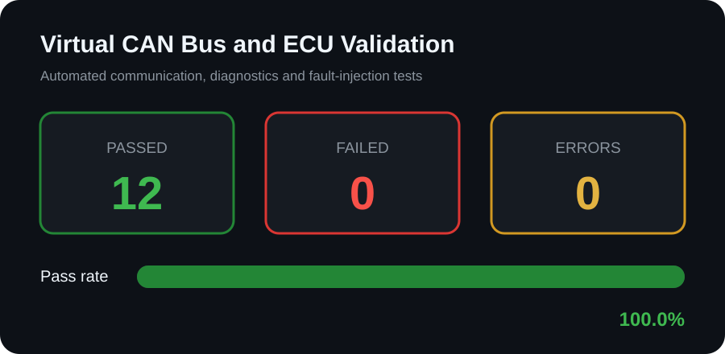

# Virtual CAN Bus and ECU Test Framework
[](https://github.com/Sathwick-kesagani/virtual-can-ecu-test-framework/actions/workflows/can-validation.yml)


A software-only automotive validation project that simulates CAN communication,
vehicle ECU signals, diagnostic behavior, communication faults and automated
testing without requiring physical CAN hardware.

> This project demonstrates simulated CAN and ECU validation. It does not claim
> experience with a physical vehicle or CAN interface.

## Validation Results



- **12 tests passed**
- **0 tests failed**
- **0 execution errors**
- **100% pass rate**

View the complete [CAN validation report](CAN_VALIDATION_REPORT.md).

## Features

- Standard 11-bit CAN arbitration IDs
- Classic CAN payload-length validation
- CAN message history and subscriber model
- Engine-RPM signal encoding and decoding
- Vehicle-speed signal transmission
- Coolant-temperature signal transmission
- Diagnostic trouble-code simulation
- CAN message-drop fault injection
- CAN data-corruption fault injection
- Communication-recovery testing
- Automated CSV results
- SVG test dashboard
- Markdown validation report

## Architecture

```text
+----------------------+        CAN Messages        +--------------------+
| Virtual Vehicle ECU  | -------------------------> | Virtual CAN Bus    |
+----------------------+                             +--------------------+
          |                                                   |
          | signals and DTCs                                  | subscribers
          v                                                   v
+----------------------+                             +--------------------+
| Signal Encoding      |                             | Validation Suite   |
+----------------------+                             +--------------------+
                                                              |
                                                              v
                                              +---------------------------+
                                              | CSV, SVG and MD Reports   |
                                              +---------------------------+
```

## Automated Test Coverage

| Test ID | Validation scenario |
|---|---|
| CAN-001 | Create a valid standard CAN message |
| CAN-002 | Reject an invalid CAN arbitration ID |
| CAN-003 | Reject an oversized classic CAN payload |
| ECU-001 | Encode and transmit engine RPM |
| ECU-002 | Encode and transmit vehicle speed |
| ECU-003 | Encode and transmit coolant temperature |
| ECU-004 | Reject out-of-range engine RPM |
| DTC-001 | Set an overtemperature diagnostic code |
| DTC-002 | Clear the diagnostic code after recovery |
| FLT-001 | Detect an injected CAN message drop |
| FLT-002 | Detect injected CAN data corruption |
| FLT-003 | Recover communication after fault removal |

## Project Structure

```text
virtual-can-ecu-test-framework/
├── .github/workflows/can-validation.yml   # CI: runs the suite on every push
├── virtual_can.py                         # Virtual CAN bus and message model
├── ecu_simulator.py                       # Vehicle ECU signals and DTCs
├── test_can_system.py                     # Automated test suite (12 tests)
├── can_report_generator.py                # Builds the SVG dashboard and report
├── can_test_results.csv                   # Latest results
├── can_test_summary.svg                   # Results dashboard
├── CAN_VALIDATION_REPORT.md               # Full validation report
├── README.md
└── LICENSE
```

## How to Run

Requires Python 3.10 or newer. No external packages are needed (standard library only).

```bash
git clone https://github.com/Sathwick-kesagani/virtual-can-ecu-test-framework.git
cd virtual-can-ecu-test-framework
```

Run the automated validation suite (exits with code 1 if any test fails):

```bash
python3 test_can_system.py
```

Generate the dashboard and validation report:

```bash
python3 can_report_generator.py
```

## Continuous Integration

GitHub Actions runs the full suite and report generator on every push and pull
request to `main`, and uploads the CSV, SVG and Markdown reports as build
artifacts. A failing test fails the build.

## Future Improvements

- Add extended 29-bit CAN identifiers
- Add message-cycle timing validation
- Add checksum and rolling-counter verification
- Add UDS diagnostic-service simulation
- Connect to physical CAN hardware in a future version

## Author

**Sri Sathwick Kesagani** · M.S. Electrical and Computer Engineering, University of Hartford ·
[LinkedIn](https://www.linkedin.com/in/sri-sathwick-kesagani-658055432)
